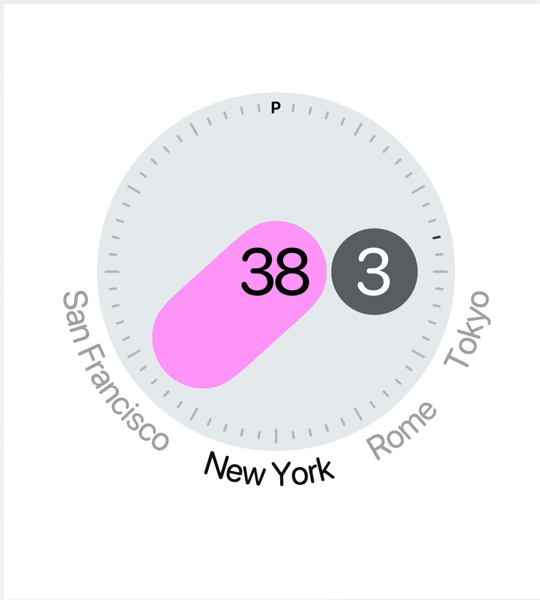

# Circle Clock

**Analog by nature. Digital by design.**

Circle Clock is an interactive world clock built to be read at a glance. It opens on Rome and lets you switch between four cities I love that roughly span the globe: **San Francisco, New York, Rome, and Tokyo**. Four is a deliberate limit, so the whole set stays scannable in seconds.

## Live Demo

Experience Circle Clock on my portfolio, inside the Manifesto section. Select a city, explore different time zones, and watch the dial transition between daylight and night.

[Explore Circle Clock](https://www.marcello.design/manifesto)

## The idea

The hierarchy follows watchmaking convention: the minute hand is longer than the hour hand. Minutes are the value you read most precisely, so they carry the pink I love, while the hour hand stays a neutral dark that contrasts with it instead of competing. Numbers sit inside the hands, so you never have to decode an angle against a scale.

The seconds indicator moves continuously at reduced opacity, and sixty ticks mark seconds and minutes. AM and PM are indicated by **A** and **P**, placed to remain legible without crowding the hands.

## Daylight and nightfall

The dial also shows the sky. As the sun goes down in the selected city, the clock transitions from its daytime appearance to a graphite-dark night mode. Dusk and dawn are gradients, not an abrupt switch.

## Motion and interaction

On load, the rim ripples with twelve waves, one for each hour, and the animation repeats every five seconds. Selecting a city changes the time zone and replays the movement as feedback. The minute hand has a subtle serpentine motion; the circular hour indicator briefly compresses and returns to its shape.

There is some initial friction, a UX trade-off I made knowingly: the hour is a circle, and the numbers live inside the hands. After a few seconds, the logic clicks, and reading and scanning become immediate.

## Implementation

Circle Clock is an SVG-based interface with HTML, CSS, and JavaScript. Time-zone formatting uses the browser's internationalization APIs, while the dial's positions are computed from time values. The implementation includes keyboard-accessible city controls and respects reduced-motion preferences.

Early versions sometimes showed the hour element detached from the dial on load due to a server/client rendering mismatch. Resolving that was part of the process.

The pink is a color I love, not a fixed brand color, and it is customizable. I think this could make a beautiful Apple Watch face.

## Status

An ongoing UI and UX exploration of world clocks, time zones, and interaction design. The interactive version is available in the **Manifesto** section of [marcello.design](https://marcello.design). Feedback is welcome through the website's contact page.

## Source and rights

This public repository documents the design and behavior of Circle Clock. The original implementation source code is not distributed here. See [RIGHTS.md](RIGHTS.md).

© 2026 Marcello Di Giovanni. All rights reserved.
